  

I build websites and web apps with React and TypeScript, and interactive 3D for the web.

### Projects

**[Anime Tracker](https://github.com/yvr1x02/anime-tracker)** · An unofficial AniList companion: what to watch tonight, continue watching, a weekly airing calendar and stats. Next.js, TypeScript, GraphQL. [Live demo](https://anime-tracker-three.vercel.app) 
**[Nockdock](https://github.com/yvr1x02/NockDock)** · A touch dashboard for the small screen under your monitors: projects, dev servers, Vercel deploys, Claude Code status and desk controls. Electron.

### Stack

**Web** · TypeScript · React · Next.js · React Native · Tailwind CSS · Node.js · NestJS · Prisma · PostgreSQL 
**3D & games** · PlayCanvas · Unity · C# · AR Foundation · Unreal Engine · Blender

[Email](mailto:yuri.impellizzeri.dev@gmail.com) · [LinkedIn](https://www.linkedin.com/in/yuri-impellizzeri-46807b25a)
