  

I build web applications with React and TypeScript, and interactive 3D for the web with PlayCanvas, at eSimple in Arezzo. 
I came to the web from games: Unreal Engine, Blender, and an AR photo booth built in Unity.

**Web** · TypeScript · React · Next.js · React Native · Tailwind CSS · Node.js · NestJS · Prisma · PostgreSQL 
**3D & games** · PlayCanvas · Unity · C# · AR Foundation · Unreal Engine · Blender

[Email](mailto:yuri.impellizzeri.dev@gmail.com) · [LinkedIn](https://www.linkedin.com/in/yuri-impellizzeri-46807b25a)
