  

I build websites and web apps with React and TypeScript, and interactive 3D for the web.

### Projects

  
  

<a href="https://anime-tracker-three.vercel.app">Try Anime Tracker live</a>

### Stack

  

[Email](mailto:yuri.impellizzeri.dev@gmail.com) · [LinkedIn](https://www.linkedin.com/in/yuri-impellizzeri-46807b25a)
