  

I build websites and web apps with React and TypeScript, and interactive 3D for the web.

### Projects

  
  

<a href="https://anime-tracker-three.vercel.app">Try Anime Tracker live</a>

### Stack

  

### Activity

  

  
  

